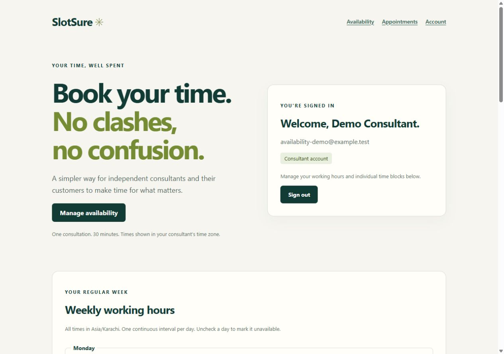
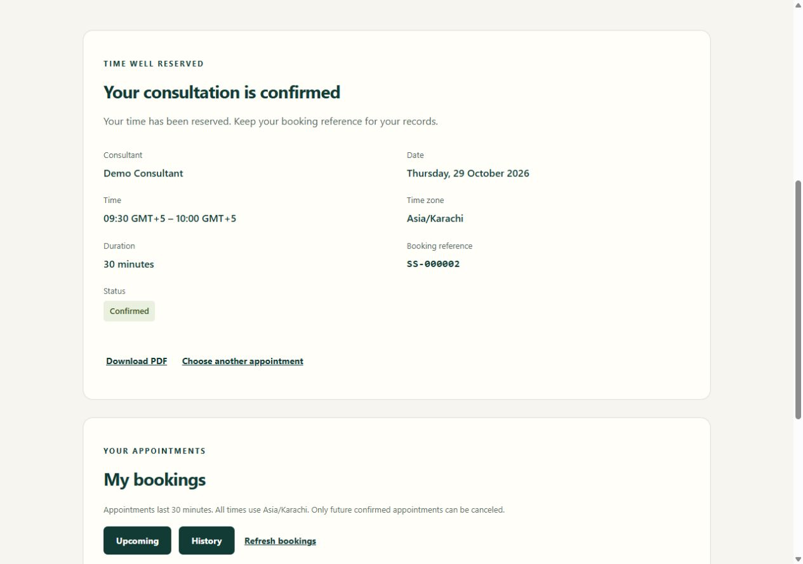

# SlotSure

**Book your time. No clashes, no confusion.**

SlotSure helps an independent consultant and their customers replace scheduling
messages with reliable appointment booking. Customers choose a time, review or cancel
appointments, and download a PDF. The consultant manages hours, blocks, and bookings.

## Status

Milestones 0–8 are implemented for local portfolio delivery. Final automated checks
passed on Node 24.19.0 and PostgreSQL 18.1; the existing Node 22.14 environment is
also supported. Customer/consultant browser journeys passed in Milestone 7.
Production serving and startup are tested over HTTP. The new compiled-client browser
check was not run because browser access to its local origin was declined.

**No public deployment or deployed HTTPS verification has been performed.** Deployment
configuration is prepared; a host, domain, database, and credentials must be supplied.
See [final verification](docs/FINAL_VERIFICATION.md) and [deployment](deploy/README.md).

## Features and boundaries

- One consultant, registered customers, one consultation type, exactly 30 minutes.
- A 14-date window in the consultant's IANA zone: today through today + 13, excluding
  appointment starts at or before now. Default zone: Asia/Karachi.
- One continuous half-hour-aligned working interval per weekday; individual blocks.
- Authenticated booking, clear conflicts, upcoming/history views, future cancellation.
- Canceled records remain stored. The owner or consultant may cancel future confirmed
  bookings; repeats return the original canceled state and timestamp.
- Authorized customer PDF downloads include truthful confirmed/canceled status.
- Responsive controls, keyboard navigation, loading/error/empty states and retry paths.

No payments, notifications, multiple consultants/types, calendar integrations,
variable durations, or AI features. Email verification and password recovery are
excluded. This is a focused portfolio MVP, not a commercial identity platform.

## Screenshots

These are real Milestone 7 desktop browser captures using synthetic data. They show
the development UI, not a public deployment. The pictured booking was later canceled.





## Stack and architecture

JavaScript, React/Vite, Express, PostgreSQL and parameterized SQL through pg. Argon2id,
express-session, connect-pg-simple, csrf-sync and express-rate-limit implement account
security. Luxon handles IANA-zone arithmetic; Intl formats browser labels. PDFKit
creates PDFs in memory; PDF.js is used only by development tests.

```text
Development: browser :5173 → Vite /api proxy → Express :3000 → PostgreSQL
Production:  browser HTTPS → one trusted TLS proxy → Express (UI + /api) → PostgreSQL
```

Routes enforce authentication/roles; services own business rules and SQL. The app is
constructed with its pool/configuration; startup owns the listener and shutdown.
React uses built-in state. Credentials never enter Vite variables or browser storage.
See [engineering decisions](docs/DECISIONS.md) and [UX review](docs/UX_REVIEW.md).

### Database and double-booking protection

| Table             | Purpose and guarantees                                                           |
| ----------------- | -------------------------------------------------------------------------------- |
| users             | Unique normalized email, customer/consultant roles, one consultant index         |
| weekly_hours      | ISO weekdays 1–7; one valid aligned interval per day                             |
| blocked_slots     | Unique finite TIMESTAMPTZ appointment starts                                     |
| bookings          | Customer FK, finite start, confirmed/canceled status with consistent canceled_at |
| user_sessions     | PostgreSQL-backed expiring sessions                                              |
| schema_migrations | Applied migration filenames                                                      |

All schedule writes use one checked-out client and transaction: lock the consultant
row with FOR UPDATE, recheck time/ownership/current schedule, mutate, commit, release.
Rollback prevents partial records. A partial unique index additionally prevents two
confirmed bookings at the same aligned start while permitting canceled history.
The shared lock also coordinates bookings with blocks and working-hour changes;
uniqueness alone cannot protect those cross-table rules. Schedule writes serialize
for this single consultant, which is an intentional MVP trade-off.

Availability is derived with one bounded statement per requested date, never one
query per slot. Slots are not persisted. Instants are stored as TIMESTAMPTZ; no
manual zone offsets are added. Tests cover DST gaps/repeated times and non-hour zones.

## Local setup

Use Node **24 LTS**, npm and PostgreSQL (verified with PostgreSQL 18.1). Node 22.14
is supported where already installed. No Docker is required.

1. Run `npm ci` at repository root.
2. For a fresh checkout, copy `server/.env.example` to `server/.env`. Preserve an
   existing configured file. Keep all real credentials in ignored files/environment.
3. Using a PostgreSQL administrator, create the application login and empty database:

```sql
CREATE ROLE slotsure LOGIN PASSWORD 'CHOOSE_A_LOCAL_PASSWORD';
CREATE DATABASE slotsure OWNER slotsure;
```

4. Set DATABASE_URL in server/.env. Percent-encode reserved password characters in a
   URI. Configure a random SESSION_SECRET of at least 32 bytes. This command replaces
   the example placeholder directly in the ignored file, without printing the secret:

```powershell
node --input-type=module -e "import fs from 'node:fs'; import {randomBytes} from 'node:crypto'; const f='server/.env'; const s=fs.readFileSync(f,'utf8').replace(/^SESSION_SECRET=.*$/m,'SESSION_SECRET='+randomBytes(32).toString('hex')); fs.writeFileSync(f,s);"
```

5. Run `npm run db:check`, then `npm run db:migrate`.
6. Create the consultant using [demo/account setup](docs/DEMO_SETUP.md). No default
   account or weekly hours are automatically installed. Customers use registration.
7. Start `npm run dev:server` and `npm run dev:client` in separate terminals. Open
   [the local application](http://127.0.0.1:5173) consistently; do not mix localhost
   with 127.0.0.1. Sign in as consultant and configure weekly hours before booking.

API liveness: [health](http://127.0.0.1:3000/api/health). Liveness is deliberately
independent of database readiness; use db:check for actual PostgreSQL connectivity.
Backend environment variables override server/.env. No frontend .env is necessary.

### Configuration

| Variable             | Meaning                                                                      |
| -------------------- | ---------------------------------------------------------------------------- |
| DATABASE_URL         | Backend-only PostgreSQL connection URL                                       |
| SESSION_SECRET       | Random secret, minimum 32 bytes; changing it invalidates cookies             |
| APP_ORIGIN           | Exact browser origin; HTTPS mandatory in production                          |
| CONSULTANT_TIME_ZONE | IANA zone, default Asia/Karachi                                              |
| HOST / PORT          | Default 127.0.0.1 / 3000; adjust Vite proxy if changing development API port |
| TRUST_PROXY          | 0 by default; 1 only behind the single trusted proxy described in deployment |
| SERVE_CLIENT         | Optional 1 for local compiled UI preview; production always serves the build |
| NODE_ENV             | production enables Secure cookies and compiled client serving                |
| TEST_DATABASE_URL    | Separate database ending in _test, used only for integration tests           |

For an HTTP compiled preview, set SERVE_CLIENT=1 and APP_ORIGIN to the Express
listener's origin, run `npm run build`, then `npm start`. Keep NODE_ENV out of
production for this HTTP-only preview; production cookies require real HTTPS.
Express serves only client/dist, with a same-origin CSP and nosniff. Missing build
fails startup. Unknown API routes remain JSON; there is no HTML fallback for them.

### Prepared Windows workspace

This workspace has an ignored password-authenticated cluster in .local/postgres,
loopback port 55432, with slotsure and slotsure_test configured in ignored server/.env.
Do not overwrite those credentials. To start it after a restart:

```powershell
& 'C:\Program Files\PostgreSQL\18\bin\pg_ctl.exe' -D .local/postgres -l .local/postgres.log -o '-h 127.0.0.1 -p 55432 -c shared_buffers=16MB' -w start
```

Stop it with the same executable and `-D .local/postgres -m fast -w stop`. Other
checkouts follow ordinary PostgreSQL setup. The local cluster is not a deployment
configuration. Stop existing development listeners before starting duplicates.

## Verification

Create slotsure_test using `npm run db:test:setup` (requires CREATEDB), or ask the
administrator to create it owned by the application login. Set TEST_DATABASE_URL in
ignored server/.env, with a database name ending in _test. Never use development data.

```powershell
npm test
npm run test:db
npm run db:check
npm run lint
npm run format:check
npm run build
```

`npm test` runs pure/HTTP/PDF/client/production tests and explicitly skips four DB
suites unless TEST_DATABASE_URL is exported. `test:db` is mandatory: it requires
explicit configuration, migrates empty unique schemas on real PostgreSQL, tests
fresh/repeat/failed migrations, seeds synthetic accounts, exercises authenticated
HTTP/races/rollback, and removes only its own schemas. It never clears development.
Final Node 24 results: **17 passed / 4 skipped** for ordinary tests; **53 passed /
0 skipped** for database tests. No failures. See the final verification report for
commands, runtime differences and checks that were not run.

## API and usage

- GET /api/auth/csrf; POST /api/auth/register, /login, /logout; GET /api/auth/me.
  Registration creates a customer, then requires sign-in. Names 1–100 characters,
  passwords 12–128. Roles cannot be chosen through registration.
- GET /api/availability?date=YYYY-MM-DD (default consultant-local today), returns
  server date bounds and UTC slot instants without customer data.
- POST /api/bookings accepts only `{ "startsAt": "explicit-offset-ISO-instant" }`.
  A valid request returns 201 only after commit; occupied times return 409.
- GET /api/bookings/my and GET /api/provider/bookings accept view=upcoming|history
  and page=1..9999; at most 50 records, with hasMore. Provider responses include
  customer name/email. Customer responses are limited to the authenticated owner.
- PATCH /api/bookings/:id/cancel accepts `{}`; owner or consultant. Past/started
  confirmed appointments return 409; foreign and missing bookings share 404.
- GET /api/bookings/:id/confirmation.pdf is customer-owner only. Canceled PDFs are
  visibly canceled, include cancellation time, and never claim a reserved time.
- Consultant GET/PUT /api/provider/hours; GET/POST /api/provider/blocks;
  DELETE /api/provider/blocks/:id. Hours replacement uses `{ "hours": [...] }`;
  each entry has weekday, startTime and endTime. Missing weekdays are unavailable.
  Blocks accept startsAt; delete accepts `{}`. Changes never silently cancel bookings.

All mutations require JSON and a session-bound X-CSRF-Token from the CSRF endpoint.
Login rotates session/CSRF state. A supplied Origin must match APP_ORIGIN. Cookies
are HttpOnly, SameSite=Lax, Secure in production, with eight-hour expiry. Sessions
live in PostgreSQL. There is no permissive cross-origin API access.

## Known limits

- No public deployment or actual deployed TLS check; compiled-client browser access
  was declined during final verification. UI journeys were verified in development.
- Login/registration counters are process-local; use a single API instance for this MVP.
- No email verification, password recovery, MFA, or claim of commercial identity readiness.
- No persistent booking idempotency replay. A lost response may hide a saved booking;
  check My bookings before retrying. Confirmation-screen state is lost on reload.
- Other tabs need refresh; offset pages can shift. Provider drafts survive refresh;
  reload intentionally discards them. Cancellation resets selected time.
- PDFs are dated snapshots, not live guarantees. Embedded font has finite coverage;
  multilingual typesetting is excluded. No permanent PDF files are stored.
- No physical-device, screen-reader matrix or exhaustive WCAG certification.
- Run one migration setup process; there is no automatic downgrade/checksum system.

Milestone development is complete for local delivery. Public deployment requires the
explicit configuration and verification steps in deploy/README.md. No deployment
address or shared demo credentials are published.
